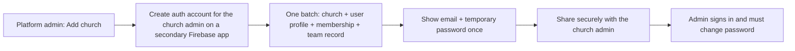
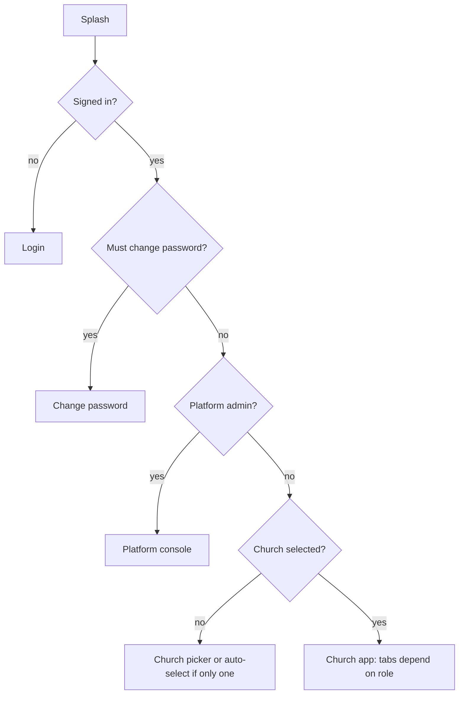

# 04 · Church Onboarding and Logins

## One-time: become the platform admin

1. Firebase console → **Authentication → Add user** (your email + password). Copy the **UID**.
2. Firestore → collection `platformAdmins` → document ID = your UID → field `name` (string).
3. Sign in to the app. You land in the **Platform console**.

## Add a church (platform admin)

Inputs: church name, country, currency, administrator name, email, temporary password (auto-generated).
If saving fails, the new auth account is deleted again, so no orphan accounts remain.

## Church admin: first sign-in and team setup

1. Sign in with the temporary password, choose a new password.
2. Open **Finance**: funds (General, Building, Missions, Welfare) and categories are created automatically.
3. Open the menu → **Team & logins** → **Add login**: name, email, role, temporary password.
   - **Accountant**: books, budgets, ordering and paying. Optional.
   - **Pastor / Staff / Leader / Member** as needed.
4. Share each login securely; each user changes the password at first sign-in.
5. Create the yearly budget (Finance → Budgets), add lines, **Make active**.

## Day-to-day account care

| Need | How |
|---|---|
| Forgotten password | Login screen → *Forgot password?* (email link) |
| Admin forgot password | Platform admin → church menu → *Send password reset to admin* |
| Change someone's role | Team & logins → menu → *Make …* |
| Switch someone off | Team & logins → *Deactivate login* (membership suspended; auth account remains) |
| Suspend a whole church | Platform console → church menu → *Suspend* |
| User in two churches | Each church creates its own membership; the user picks a church after sign-in |

## Navigation rules in the app

## Known limits and next steps

- Creating logins uses a **secondary Firebase app** in the client. It works without Cloud Functions, but for production consider a callable Cloud Function using the Admin SDK (also needed to **delete** auth accounts and to disable users at the auth level).
- Deactivating a login blocks church data through the rules but does not disable the Firebase auth account.
- Temporary passwords are visible to whoever creates the login; they must be shared over a secure channel.
